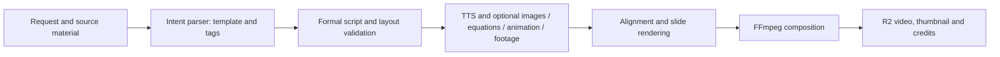

# Výstup 2: nové video šablony a moduly

Výstup rozšiřuje generátor o formální výuková videa ve formátech 16:9 a 9:16. Nové šablony využívají samostatný modul pro strukturované výukové snímky a modul pro vyhledání a vložení videozáběrů. Backend vybírá šablonu podle tématu, cílové skupiny a požadovaného formátu; ruční volba uživatele má přednost. Součástí jsou reprodukovatelné ukázky, testy skutečného renderování a tento popis zapojení.

## Templates

- **`lecture`**: 1920 × 1080. Warm paper palette, aligned text and photo columns, and horizontal layouts for short processes and comparisons. For courses, academic explanations and workplace training.
- **`documentary`**: 1920 × 1080. Dark background, large footage panel and concise teaching notes. Stock footage is enabled by default. A missed search produces a complete teaching slide without an empty footage panel.
- **`briefing`**: 1080 × 1920. Large portrait photography followed by teaching notes, with a compact text-only layout when visuals are unavailable. For mobile revision and professional explainers. Bundled Inter and DejaVu Sans fonts support Czech diacritics.

All three use the selected avatar's **voice**, without generating a visible avatar, lipsync, or gameplay. Existing gameplay and song templates remain available. The formal writing brief replaces the default entertainment brief, including its persona instructions. Additional custom script instructions are retained.

The picker displays each template's description and aspect ratio. Widescreen previews and video thumbnails are contained rather than cropped into portrait frames. The video player already supports both orientations; its Details & credits view exposes descriptions and clickable footage attribution.

## Install the catalog entries

Deploy the backend and web changes together. No database schema migration is required: template specifications remain JSON, and the public catalog's new description/width/height fields are computed from the registered template class.

```bash
# Inspect additions without changing the database.
python -m api.install_formal_templates

# Add only missing formal templates; preserve existing configurations and prices.
python -m api.install_formal_templates --apply
```

The installer reads the existing `DATABASE_URL`. It inserts the three new entries at **1 credit per video**, matching the existing default; adjust prices through the existing admin interface if required. It never replaces an existing row. Existing CLI configurations also include the new names.

The web build includes small preview MP4s and PNGs. For absolute preview URLs usable by API/MCP clients, upload these through the existing R2 configuration during initial installation:

```bash
python -m api.install_formal_templates --apply --previews web/public/template-previews
```

To refresh preview URLs for existing entries while preserving their configuration and price, run:

```bash
python -m api.install_formal_templates --apply --previews web/public/template-previews --refresh-previews
```

Preview URLs contain a content hash so cached originals do not mask a new design.

## Slide module

The `slides` module turns typed `SlideMedia` into PNG assets. It uses the same provider registry as other modules:

- `pillow` (default): deterministic CPU rendering in the application worker. No API key, GPU, browser, or additional service is needed.
- `modal_slides`: optional remote execution of the same renderer, returning a PNG over authenticated HTTP.

Layouts are `title`, `bullets`, `process`, `comparison`, `chart`, and `quote`. Comparisons contain exactly two alternatives. Process cards are numbered. Horizontal charts support positive and negative values, share a zero baseline, and require a source label; invented teaching data must be labelled as an illustrative example. Layout validation cannot independently establish whether a citation is true, so the writing instructions explicitly prohibit invented factual data and citations.

Text uses actual glyph measurements, wrapping and bounded font reduction. Dense content fails validation instead of being silently cropped or made unreadably small. Before paid assets are generated, the formal script validator checks both the visual-panel layout and the full-slide fallback. The LLM gets one corrective retry with the validation error. The renderer accepts structured data only, with no model-generated HTML or executable code.

Each narration block contains exactly one slide. One supporting visual fills the scene, while two share it. The backend can use a valid word index for the changeover and otherwise divides the scene in script order. A single remaining visual fills the panel if the other asset is unavailable. The small markers in the header identify scenes; elapsed playback time is shown by the video player's controls.

Images are enabled by default on all three formal templates. The selected image provider supplies photos for relevant scenes, with Unsplash as the default. Photos and stock footage fill the panel with a centred crop. Equations and teaching animations are fitted to preserve labels. Missing optional photos fall back to the slide without automatically calling RunPod. Unsplash photos carry the photographer credit and a profile link. [Unsplash API guidelines](https://help.unsplash.com/en/articles/2511245-unsplash-api-guidelines)

Example block (the trigger covers its six narration words):

```json
{
  "type": "dialogue",
  "avatar": "Narrator",
  "text": "Observe a pattern and test it.",
  "media": [{
    "type": "slide",
    "layout": "process",
    "title": "From observation to evidence",
    "subtitle": "",
    "items": [
      {"heading": "Observe", "body": "Notice a pattern."},
      {"heading": "Test", "body": "Check your explanation."}
    ],
    "trigger": {"start_word_index": 0, "end_word_index": 5}
  }]
}
```

`PresentationStyle` in `template_config.presentation_style` controls the palette (`paper`, `midnight`, `slate`), six-digit hex accent colour, brand name, caption visibility, and background music volume. Omitting this object selects the template's own palette. Output dimensions are fixed per template to preserve readable layouts. Alignment still runs when captions are hidden because visual triggers use word timestamps.

## Stock video module

`StockVideoMedia` contains only `keywords` and the existing word trigger. The script cannot choose a file path or download URL.

- **`auto`** (default): use Pexels when `PEXELS_API_KEY` is present, otherwise use the local library.
- **`library`**: search an operator-curated JSON manifest of licensed local files. Requires no external service. The script prompt omits footage when the library is empty, leaving the available image option and teaching slide.
- **`pexels`**: search the [Pexels video API](https://www.pexels.com/api/documentation/) with the video's orientation. Explicit selection requires `PEXELS_API_KEY`. The provider selects a bounded HD rendition, retries rate limits/server errors, checks download hosts and redirects, caps downloads at 120 MiB, and verifies the video stream with ffprobe. Authentication is sent only to the API endpoint.

Downloads use a 45-second request timeout and at most two simultaneous clip requests by default. Stock audio is never mixed into narration. Short clips hold their final frame; long clips are trimmed to their trigger window. Source identity and license are stored with the checkpoint. The creator/provider credit appears in the video footer; full attribution and links appear in the final description. Preserve these credits when redistributing a video. See [Pexels API guidelines](https://www.pexels.com/api/documentation/) and the [Pexels license](https://www.pexels.com/license/) for provider-specific requirements.

Library example:

```json
[
  {
    "path": "laboratory.mp4",
    "keywords": ["laboratory", "microscope", "research"],
    "creator": "Your organisation",
    "source_url": "https://example.org/media/laboratory",
    "license": "Owned by your organisation"
  }
]
```

Set `STOCK_VIDEO_MANIFEST` to its path, or pass `manifest_path` in the provider configuration. Clip paths must stay inside the manifest's directory. Originals are copied to managed output paths, so pipeline cleanup cannot delete library masters. Library selection uses matching keyword tokens; curate tags in English to match the script's search terms. The included cloud library is for the examples, not a generic fallback for unrelated topics.

Configure a strict failure policy with `failure_mode: "error"`; the default `"fallback"` logs stock retrieval failures and continues with the slide. Storage upload failures remain fatal so an apparently successful checkpoint cannot lose its assets on an ephemeral worker.

## Backend integration and providers



Template descriptions enter the existing REST/MCP intent parser catalog. It can distinguish formal widescreen lessons, footage-led explainers, portrait briefings and entertainment formats. Manual selections retain priority.

`StockVideoGenerator` runs in PRIMARY alongside TTS and other media. `SlideGenerator` runs in SECONDARY, after footage availability is known. Both write into `BlockAssets.media_map` and `media_url_map`, using the normal local/remote asset-pair contract. Provenance is stored in `media_attributions`. Slides also produce correctly proportioned thumbnails without calling an image API. Checkpoint JSON, restoration on a fresh worker, final descriptions and cleanup include these new artifacts.

Only selected providers are instantiated. A lecture with no optional tags does not require image, lipsync, Manim or song credentials. Narration and word alignment continue to use your existing providers. Formal exports default to the high-quality compression profile with a 6 Mbps video cap unless explicitly overridden. FFmpeg normalises audio channels/sample rates, pads each scene to a video-frame boundary, and keeps captions outside the teaching content. A scene is trimmed **after** overlay composition, avoiding the framesync EOF stall reproduced during longer-footage testing. Local renders have a configurable 1800-second timeout and terminate their subprocess on timeout/cancellation.

The live script smoke check exposed a retired existing Gemini default. The provider now defaults to `gemini-3.1-pro-preview`, following [Google's migration guidance](https://ai.google.dev/gemini-api/docs/models/gemini-3-pro-preview). Generation profiles that explicitly pin `gemini-3-pro-preview` must also be updated; explicit model selections are preserved.

A live check also passed through the existing Groq provider using `openai/gpt-oss-120b`: it generated three formal scenes, exercised the corrective retry, and passed the slide/trigger/overflow validator. To use that configuration with `GROQ_API_KEY`, include the following in the generation profile:

```json
{
  "script_config": {
    "provider": "groq",
    "provider_config": {"model": "openai/gpt-oss-120b"}
  }
}
```

This model supports the strict structured-output contract used by the existing provider; see [Groq structured outputs](https://console.groq.com/docs/structured-outputs). Live validation checks the script contract, not independent factual or linguistic accuracy.

New `ShortsConfig` fields are also accepted by database `GenerationConfig` profiles:

```json
{
  "slides_config": {
    "provider": "pillow",
    "provider_config": {"max_concurrent": 3}
  },
  "stock_video_config": {
    "provider": "auto",
    "provider_config": {"max_concurrent": 2, "failure_mode": "fallback"}
  }
}
```

Keep `upload: true` (the default) for production checkpoints. `upload: false` is intended for local demos/tests only. Provider API keys belong in environment variables, not script JSON or the public catalog.

CLI example using an existing configured voice:

```bash
python cli/main.py --template lecture --avatars YOUR_EXISTING_AVATAR \
  --input "Create a formal lesson on the water cycle"
```

## Optional Modal deployment

The default Pillow renderer runs in the normal worker and needs no deployment. To offload it:

1. Install the Modal CLI in your deployment environment and authenticate it.
2. Create a Modal secret named `aishorts-slides` with a randomly generated `MODAL_SLIDES_API_KEY`.
3. From the repository root, run `modal deploy scripts/modal_slides.py`.
4. Set `MODAL_SLIDES_ENDPOINT_URL` to the returned ASGI endpoint URL (including `/`) and set the matching `MODAL_SLIDES_API_KEY` on the application worker.
5. Set `slides_config.provider` to `modal_slides` in the selected generation profile.

The service uses one CPU, 1 GiB of memory, a 90-second execution timeout and at most four containers. It installs the same package and bundled fonts, accepts at most 64 KiB of structured input, validates the bearer token, and returns image/png. It mounts only project source, packaging metadata and README, never `.env`. The client enforces its own timeout, PNG size limit and image-dimension checks. No R2 credentials are needed in the slide service; the application uploads its result.

Redeploy the slide service with the worker when updating the slide design so the generated slide and composited media use the same coordinates.

Existing Modal FFmpeg endpoints can render the new filter graphs. Ensure their FFmpeg build includes `ass`, `loop`, `overlay`, `tpad`, `concat`, `dynaudnorm` and the standard audio/scale filters, plus `fonts-dejavu-core` for captions. Your existing endpoint URLs and selection remain unchanged. Reference: [Modal images](https://modal.com/docs/guide/images), [Modal web endpoints](https://modal.com/docs/guide/webhooks), [FFmpeg filters](https://ffmpeg.org/ffmpeg-filters.html).

## Samples and verification

The reproducible examples use local `espeak-ng` speech and estimated word timing to avoid paid APIs. Production retains your existing TTS and forced-alignment providers. These samples demonstrate templates/modules and rendering; they do not establish the quality of any live speech service.

```bash
python scripts/render_formal_examples.py \
  --stock-manifest examples/formal/stock/manifest.json \
  --previews web/public/template-previews
```

Outputs are `output/formal-examples/{lecture,documentary,briefing}.mp4`, their thumbnails, editable `.script.json` examples and populated `.checkpoint.json` files. The previews include short excerpts from several scenes. Omitting `--stock-manifest` exercises the no-footage fallback. Source credits accompany the [photographs](../examples/formal/photos/CREDITS.md) and [cloud footage](../examples/formal/stock/CREDITS.md). The portrait example is in Czech.

Run the affected offline suite and web build:

```bash
python -m pytest tests/test_formal_video.py tests/test_mcp.py \
  tests/test_plan_service.py tests/test_api_guards.py tests/test_script_generator.py -q
cd web
npm run build
```

The affected suite covers each layout in both orientations, visual timing recovery and handover, image attribution and fallback, stock retrieval, real FFmpeg rendering, and restoring the pipeline from a checkpoint.

Live Pexels credentials and a deployed Modal slide endpoint require a staging smoke test in your environment before enabling those optional providers. They are not needed for the default slide renderer or local library.

At verification time, the local Gemini account returned a zero-quota response, the OpenAI credential was rejected, and NVIDIA reported its configured `minimaxai/minimax-m2.5` model had reached end of life. These external configurations must be corrected if selected for deployment. No credentials, billing settings or database generation profiles were changed.

Some older repository tests predate the current APIs (for example, `test_ffmpeg_providers.py` imports the removed `FFmpegAPI` class). These unrelated legacy failures are not evidence that the whole historical suite passes; the commands above identify the verified affected set.
